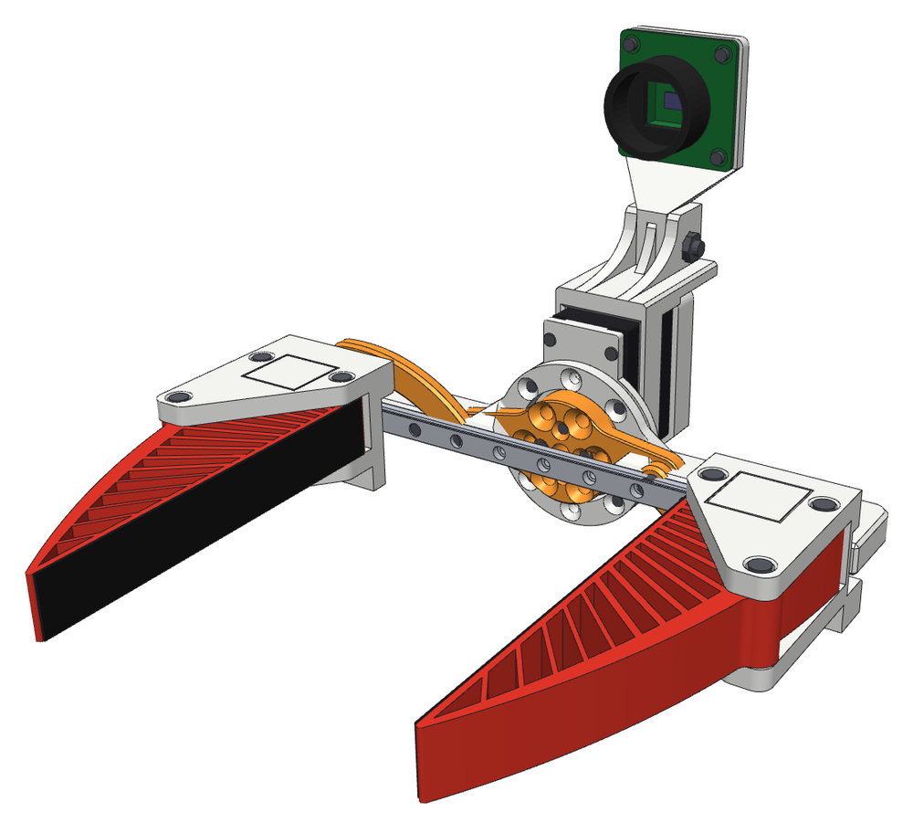
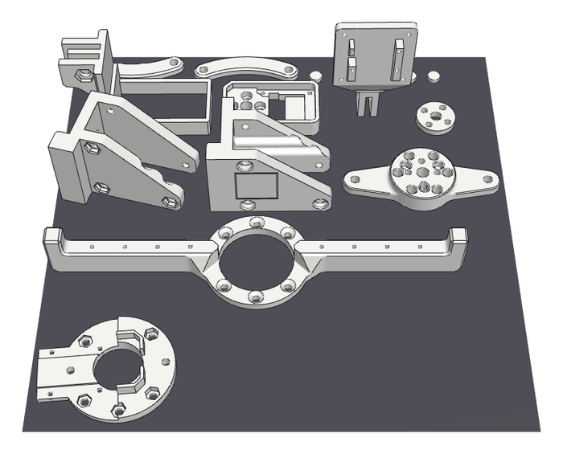
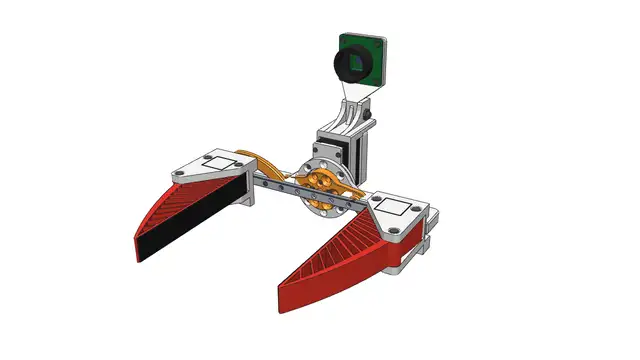

# solarian-gripper1

A parallel gripper module for the Solarian framework. Two fingers, one actuator;
you command it by the desired **finger aperture in millimetres** and the module
handles the conversion for both real hardware and simulation.

The plugin ships **two actuator variants** that share the same finger kinematics
and aperture command space:

| Variant | Module | Default config | MJCF |
| --- | --- | --- | --- |
| Feetech STS | `Gripper1FeetechModule` | `conf_gripper_feetech.yaml` | `assets/gripper1.xml` |
| Robstride L7 | `Gripper1RobstrideModule` | `conf_gripper_robstride.yaml` | `assets/gripper1_robstride.xml` |

## Build your own



Everything you need to build the **Feetech variant**: the parts to buy, the
parts to print, and an animated step-by-step [assembly guide](docs/assembly.md).

| | |
| --- | --- |
| 🛒 [Sourcing parts](#sourcing-parts) | bill of materials with US and EU links |
| 🖨️ [Printing the parts](#printing-the-parts) | settings, orientation, ready-made plates |
| 🔧 [Assembly guide](docs/assembly.md) | 13 steps, each with an animation ([full video](docs/media/assembly/assembly_full.mp4)) |
| 📐 [STEP](STEP/solarian-gripper1.step) / [STL](STL/) | CAD of the assembly and print-ready parts |

### Sourcing parts

Prices are rough (November 2026) and per gripper. Links point to a specific
listing where we have one and to a store search otherwise, so check the
listing matches the spec before you order.

#### Motion and electronics

| Part | Qty | ≈ Price | Buy (US) | Buy (EU) |
| --- | --- | --- | --- | --- |
| **Feetech STS3250** servo, 12 V, 50 kg·cm (C001) — what we use<sup>1</sup> | 1 | $125 | [OpenELAB](https://openelab.io/products/feetech-sts3250-c001-ttl-servo) · [Amazon](https://www.amazon.com/s?k=Feetech+STS3250+12V+servo) | [OpenELAB](https://openelab.io/de/products/feetech-sts3250-c001-ttl-servo) · [Amazon.de](https://www.amazon.de/s?k=Feetech+STS3250+Servo) |
| *or* Feetech STS3215 servo, 12 V, 1/345 (C018) | 1 | $28–49 | [OpenELAB](https://openelab.com/products/feetech-sts3215-c018-servo-12v) · [RobotShop](https://robotshop.com/products/feetech-12v-30kgcm-magnetic-encoding-servo-sts3215) · [Amazon](https://www.amazon.com/s?k=Feetech+STS3215+12V+30kg+servo) | [RobotShop EU](https://eu.robotshop.com/products/feetech-12v-30kgcm-magnetic-encoding-servo-sts3215) · [OpenELAB](https://openelab.io/de/products/feetech-sts3215-c018-servo-12v) · [Amazon.de](https://www.amazon.de/s?k=Feetech+STS3215+12V+servo) |
| Waveshare Bus Servo Adapter (A)<sup>2</sup> | 1 | $5–11 | [Waveshare](https://www.waveshare.com/bus-servo-adapter-a.htm) · [Amazon](https://www.amazon.com/s?k=Waveshare+serial+bus+servo+driver+board+ST+SC) | [Waveshare](https://www.waveshare.com/bus-servo-adapter-a.htm) · [Amazon.de](https://www.amazon.de/s?k=Waveshare+Bus+Servo+Adapter) |
| 12 V DC power supply, ≥ 5 A, 5.5 × 2.1 mm plug<sup>2</sup> | 1 | $15 | [Amazon](https://www.amazon.com/s?k=12V+5A+power+supply+5.5x2.1mm) | [Amazon.de](https://www.amazon.de/s?k=Netzteil+12V+5A+5%2C5x2%2C1) |
| USB-C cable (adapter → computer) | 1 | $5 | [Amazon](https://www.amazon.com/s?k=USB+C+cable) | [Amazon.de](https://www.amazon.de/s?k=USB+C+Kabel) |
| MGN7 linear rail, **150 mm**, with 2× MGN7C carriages | 1 set | $15–25 | [AliExpress](https://www.aliexpress.com/w/wholesale-MGN7C-linear-rail.html) · [Amazon](https://www.amazon.com/s?k=MGN7+linear+rail+MGN7C+carriage) | [AliExpress](https://www.aliexpress.com/w/wholesale-MGN7C-linear-rail.html) · [Amazon.de](https://www.amazon.de/s?k=MGN7+Linearf%C3%BChrung+MGN7C) |

#### Wrist camera

| Part | Qty | ≈ Price | Buy (US) | Buy (EU) |
| --- | --- | --- | --- | --- |
| Raspberry Pi High Quality Camera (C/CS mount) | 1 | $50 | [Raspberry Pi](https://www.raspberrypi.com/products/raspberry-pi-high-quality-camera/) · [Amazon](https://www.amazon.com/s?k=Raspberry+Pi+High+Quality+Camera) | [Raspberry Pi](https://www.raspberrypi.com/products/raspberry-pi-high-quality-camera/) · [Amazon.de](https://www.amazon.de/s?k=Raspberry+Pi+High+Quality+Camera) |
| Wide-angle lens for the HQ camera (the one we use) | 1 | see listing | [Amazon](https://a.co/d/099ClVkA) | [same listing](https://a.co/d/099ClVkA) |
| CSI-to-HDMI extension adapter (camera-side + computer-side board)<sup>3</sup> | 1 kit | see listing | [Amazon](https://a.co/d/02A3CINp) | [same listing](https://a.co/d/02A3CINp) |
| Thin, flexible HDMI cable (camera → computer) | 1 | see listing | [Amazon](https://a.co/d/017VPv34) | [same listing](https://a.co/d/017VPv34) |
| Camera ribbon (FPC) cable, 15-pin ↔ 15-pin, short (camera → camera-side adapter) | 1 | $5 | [Amazon](https://www.amazon.com/s?k=raspberry+pi+camera+FPC+cable+15+pin+to+15+pin+10cm) | [Amazon.de](https://www.amazon.de/s?k=Raspberry+Pi+Kamera+Flachbandkabel+15+Pin+15+Pin) |
| Camera ribbon (FPC) cable, 15-pin → 22-pin or 15-pin (computer-side adapter → Pi / Jetson)<sup>4</sup> | 1 | $5 | [Amazon](https://www.amazon.com/s?k=raspberry+pi+5+camera+cable+15+pin+to+22+pin) | [Amazon.de](https://www.amazon.de/s?k=Raspberry+Pi+5+Kamerakabel+15+auf+22+Pin) |

#### Fasteners

| Fastener | Qty | Where |
| --- | --- | --- |
| M2×5 socket head screw | 8 | carriages → finger holders |
| M2×6 socket head screw | 12 | rail → rack (4), gripper holder → servo (4), arm adapter → servo (4) |
| M2×8 socket head screw | 6 | camera → holder (4), CSI-to-HDMI adapter → holder (2, if the kit has no screws) |
| M3×10 socket head screw | 6 | arm adapter → arm's wrist-roll horn (4), links → finger holders (2) |
| M3×14 socket head screw | 2 | links → crank |
| M3×10 countersunk screw | 4 | rack → gripper holder |
| M3×14 countersunk screw | 4 | crank → servo horn |
| M3×25 socket head screw | 6 | fingers → finger holders |
| M3 hex nut | 10 | fingers (6), rack → gripper holder (4) |
| M3 nylon lock nut | 2 | links → crank |
| M3 heat-set insert (≈ 4.8 mm OD, ≈ 4 mm long) | 2 | finger holder link pins |
| M5×20 socket head screw + M5 nut | 1 + 1 | camera mount hinge |

Most of these come from a few assortment boxes:

| Kit | ≈ Price | Buy (US) | Buy (EU) |
| --- | --- | --- | --- |
| M2 socket head screw assortment | $10 | [Amazon](https://www.amazon.com/s?k=M2+socket+head+cap+screw+assortment+kit) | [Amazon.de](https://www.amazon.de/s?k=M2+Zylinderkopfschrauben+Sortiment+Innensechskant) |
| M3 socket head screw + nut assortment | $12 | [Amazon](https://www.amazon.com/s?k=M3+socket+head+cap+screw+nut+assortment+kit) | [Amazon.de](https://www.amazon.de/s?k=M3+Zylinderkopfschrauben+Muttern+Sortiment) |
| M3 countersunk (flat head) screws, 10–14 mm | $9 | [Amazon](https://www.amazon.com/s?k=M3+countersunk+flat+head+socket+screw+assortment) | [Amazon.de](https://www.amazon.de/s?k=M3+Senkkopfschrauben+Sortiment+Innensechskant) |
| M3 heat-set inserts | $8 | [Amazon](https://www.amazon.com/s?k=M3+heat+set+inserts+3D+printing) | [Amazon.de](https://www.amazon.de/s?k=Gewindeeins%C3%A4tze+M3+3D+Druck) |
| M3 nylon lock nuts, M5×20 screw + nut | $6 | [Amazon](https://www.amazon.com/s?k=M3+nylon+lock+nut) · [M5](https://www.amazon.com/s?k=M5+x+20+socket+head+screw+nut) | [Amazon.de](https://www.amazon.de/s?k=M3+Sicherungsmutter) · [M5](https://www.amazon.de/s?k=M5x20+Zylinderschraube) |

The servo horn, its centre screw and the servo cable come in the servo box.

#### Filament and extras

| Part | Qty | ≈ Price | Buy (US) | Buy (EU) |
| --- | --- | --- | --- | --- |
| PLA+ filament | ≈ 120 g | $3 | [Amazon](https://www.amazon.com/s?k=PLA%2B+filament+1.75mm) | [Amazon.de](https://www.amazon.de/s?k=PLA%2B+Filament+1%2C75) |
| TPU 95A filament | ≈ 80 g | $3 | [Amazon](https://www.amazon.com/s?k=TPU+95A+filament+1.75mm) | [Amazon.de](https://www.amazon.de/s?k=TPU+95A+Filament+1%2C75) |
| Anti-slip pad, 18 × 119 mm strip (optional) | 2 | $5 | [Amazon](https://www.amazon.com/s?k=anti+slip+grip+tape) | [Amazon.de](https://www.amazon.de/s?k=Antirutschband) |

**Total:** about **$120–150** for the gripper with an STS3215, or roughly $100
more with the STS3250. The wrist camera adds the HQ camera ($50), the lens, the
HDMI extension kit and cables.

**Tools:** hex keys 1.5 / 2 / 2.5 / 3 mm, a small Phillips screwdriver and a
soldering iron for the heat-set inserts.

<sup>1</sup> We build it with the STS3250 for the extra torque; the STS3215 has
the same body and mounting, so it fits as is. The 7.4 V STS3215 (C001) works
too: match the power supply to the servo voltage and don't mix voltages on one
bus.<br>
<sup>2</sup> Skip these if the gripper shares the servo bus and supply of your
arm (e.g. an SO-101 or solarian-arm1 with Feetech servos); just give the
gripper its own servo ID. The STS3250 can draw about 4 A at stall, so size a
shared supply for it.<br>
<sup>3</sup> The camera-side board is screwed to the back of the camera holder
with two screws, HDMI port pointing down and back. The HDMI cable runs along
the arm to the computer-side board, so you avoid a long, fragile ribbon cable.<br>
<sup>4</sup> 22-pin for a Raspberry Pi 5 or a Jetson Orin Nano; 15-pin for
older Raspberry Pis. Check your board's CSI connector.

### Printing the parts



#### Step 1: Choose a printer

Any FDM printer with a bed of at least **220 × 220 mm** works. The longest
part, the rack, is 191 mm. Prusa MK3/MK4/MINI+, Creality Ender 3, Bambu Lab
A1/P1/X1 and similar are all fine. The fingers need a printer that handles
TPU 95A (a direct-drive extruder helps).

#### Step 2: Set up the printer

| | Rigid parts | Fingers |
| --- | --- | --- |
| Material | PLA+ (PETG also works) | TPU 95A |
| Nozzle / layer | 0.4 mm / 0.2 mm | 0.4 mm / 0.2 mm |
| Walls | 3 | 3 |
| Infill | 30 % gyroid | 20 % |
| Supports | see table below | none |
| Speed | printer default | 20–30 mm/s |

Clean and level the bed, and use glue stick if your sheet needs it. For the
TPU fingers, print slowly and turn retraction down.

#### Step 3: Check the fit

Before printing everything, print the `horn_spacer_3.5_mm` (10 minutes) and
check that an M3 screw passes through its holes. If the holes are tight, set
your slicer's hole/XY compensation before printing the rest.

#### Step 4: Print the parts

All STLs are already **rotated into their print orientation**: drop them on
the plate and slice. Either print the ready-made plates:

- [`STL/Plates/gripper1_PLA_plate_220x220.stl`](STL/Plates/gripper1_PLA_plate_220x220.stl): every rigid part, one plate
- [`STL/Plates/gripper1_TPU_fingers_220x220.stl`](STL/Plates/gripper1_TPU_fingers_220x220.stl): both fingers

or the individual parts in [`STL/Individual`](STL/Individual):

| Part | Qty | Material | Supports | Notes |
| --- | --- | --- | --- | --- |
| [`rack.stl`](STL/Individual/rack.stl) | 1 | PLA | touching build plate | carries the rail; 30 %+ infill |
| [`feetech_gripper_holder.stl`](STL/Individual/feetech_gripper_holder.stl) | 1 | PLA | no | |
| [`finger_holder_left_n.stl`](STL/Individual/finger_holder_left_n.stl) | 1 | PLA | yes | |
| [`finger_holder_right_n.stl`](STL/Individual/finger_holder_right_n.stl) | 1 | PLA | yes | mirror of the left one |
| [`crank.stl`](STL/Individual/crank.stl) | 1 | PLA | no | 40 % infill, takes the servo torque |
| [`link-1.stl`](STL/Individual/link-1.stl), [`link-2.stl`](STL/Individual/link-2.stl) | 1 + 1 | PLA | no | 100 % infill recommended |
| [`feetech_back_holder_to_horn.stl`](STL/Individual/feetech_back_holder_to_horn.stl) | 1 | PLA | no | arm adapter |
| [`horn_spacer_3.5_mm.stl`](STL/Individual/horn_spacer_3.5_mm.stl) | 1 | PLA | no | |
| [`feetech_camera_mount_bottom.stl`](STL/Individual/feetech_camera_mount_bottom.stl) | 1 | PLA | yes | |
| [`camera_holder_v3.stl`](STL/Individual/camera_holder_v3.stl) | 1 | PLA | yes | add a brim, it stands upright |
| [`soft_gripper_finger.stl`](STL/Individual/soft_gripper_finger.stl) | 2 | TPU 95A | no | |

#### Step 5: Remove supports

Take the parts off the plate with a putty knife or by flexing the sheet, then
remove supports, especially from the finger holders' screw holes and the
camera mount hinge.

#### Don't own a 3D printer?

Upload the plate STLs to a printing service (JLCPCB, Craftcloud, PCBWay,
or a local makerspace) with the settings above.

### Assembly

Follow the [assembly guide](docs/assembly.md): 13 short steps, each with an
animation rendered from the CAD. The whole build as one video:
[`assembly_full.mp4`](docs/media/assembly/assembly_full.mp4).



The animations, print orientations and plates are generated from the Onshape
assembly by [`tools/assembly_render`](tools/assembly_render/README.md), so they
can be regenerated whenever the CAD changes.

## Installation

```bash
pip install solarian-gripper1             # Feetech variant
pip install "solarian-gripper1[hardware]" # plus the Feetech servo SDK, on the machine wired to the gripper
```

The Robstride variant needs `solarian-robstride`, which is not on PyPI yet.
Install it from source alongside the gripper:

```bash
pip install -e "plugins/solarian-robstride[hardware]"
pip install -e "plugins/solarian-gripper1[robstride]"
```

## How it works

- Each module exposes a single actuator (`gripper`), matching the single
  physical servo. It converts an aperture command (mm) into the servo's
  normalized command space and writes that. Each backend maps normalized → physical:
  - **Real**: normalized → servo counts via the actuator calibration.
  - **Sim**: normalized → both jaw joints. `sim_joint` is the left slide;
    `sim_followers` drives the right slide through its own exported limits.
- The URDF gives each jaw its own joint and actuator. One command opens and
  closes both because the same normalized value is mapped through each range.

## Regenerating the sim model

Each variant has its own CAD assembly. Export a URDF plus STL meshes from the CAD tool and import it:

```bash
solarian cad-import solarian_gripper1/assets/gripper1_description --urdf gripper.zip --density 522
solarian cad-import solarian_gripper1/assets/gripper1_robstride_description --urdf gripper.zip --density 522
```

The Feetech import writes `solarian_gripper1/assets/gripper1.xml`; the Robstride import writes `solarian_gripper1/assets/gripper1_robstride.xml`. Both jaw joints are actuators. `left_manifold_to_rail` runs `[0, 0.0545]` m (0 = fingers apart, 0.0545 = fingers together). `right_manifold_to_rail` runs the mirror, `[-0.0545, 0]`. One gripper command drives both through `sim_followers`.

## Using it in a robot

1. Attach the model in your robot's sim `SceneConfig`, with a `prefix` matching
   the one in the gripper yaml (`gripper/`):

```python
from solarian.sim import SceneConfig, ModuleAttachment
from solarian_gripper1 import MJCF_FEETECH_PATH as GRIPPER_MJCF
from solarian_gripper1.gripper_feetech import Gripper1FeetechModule

class MyRobot(Robot):
    is_sim = True
    gripper = Gripper1FeetechModule()

    scene = SceneConfig(
        attachments=[
            ModuleAttachment(
                module="gripper",
                # Loaded straight from the installed plugin (meshes resolve
                # relative to the MJCF) -- no need to copy the model into your
                # project, so there's a single source of truth.
                mjcf=GRIPPER_MJCF,
                parent_body="right/wrist_flange",   # the arm flange body
                prefix="gripper/",
            ),
        ],
    )
```

For the Robstride variant, import `Gripper1RobstrideModule` and
`MJCF_ROBSTRIDE_PATH` instead. Both MJCFs attach at the `flange` site.

Both MJCFs export CAD Frames as sites: `flange` (mate to the arm),
`camera` (wrist lens), and `tcp` (tool center point). Pass
`Gripper1FeetechModule.tcp_from_flange` or
`Gripper1RobstrideModule.tcp_from_flange` to the arm as `ik_tcp` so IK tracks
that variant's flange plus its CAD offset.

Site-mate example (solarian-arm1 and this gripper both export a `flange` Frame):

```python
ModuleAttachment(
    module="right_gripper",
    mjcf=GRIPPER_MJCF,
    parent_site="right/flange",
    child_site="flange",
    prefix="right_gripper/",
)
```

2. Copy the matching yaml (`conf_gripper_feetech.yaml` or
   `conf_gripper_robstride.yaml`) into your project's `conf/` and set the real
   `port`/`id`, then run `solarian calibrate` on the gripper: sweep the
   full closed↔open travel, then move to the **fully closed** pose when asked
   so `drive_mode` matches `aperture_closed_mm` / `aperture_open_mm`.

3. Run `solarian calibrate-gripper-ranges` and read a ruler at each stop. This
   records `aperture_table`, the measured aperture curve. Skipping it leaves the
   module interpolating a straight line between the two endpoints, which the
   linkage does not follow.

4. Command the gripper by aperture in mm — send a waypoint whose `gripper` value
   is the aperture (e.g. `85` = fully open, `0` = closed). Read the current
   aperture with `module.read_aperture()`.

## Configuration

Fields specific to both modules:

- `aperture_table` — ruler-measured `norm` / `aperture_mm` pairs written by
  `solarian calibrate-gripper-ranges`. When present it defines the travel and
  the mm ↔ normalized map, superseding the two endpoint fields below.
- `aperture_closed_mm` / `aperture_open_mm` — physical fingertip separation at
  the two ends of travel, used for a straight-line map until a table is
  measured. Keep them consistent with the servo calibration and the `sim:`
  joint range.
- `actuators.gripper.sim` — maps the servo to `gripper/left_manifold_to_rail`,
  `range_min: 0.0` / `range_max: 0.0545` (the joint limits), `drive_mode: 1` so
  normalized -100 = closed, 100 = open.
- `interpolator_type: scalar` — GripperModule interpolates aperture in mm.

## License

[Apache License 2.0](LICENSE). Copyright 2026 PrimaryKey Inc. The hardware
files (`STL/`, `STEP/`, `docs/media/`, `tools/assembly_render/cad/`) are under
the same license. Parts of the mechanical design and meshes in
`solarian_gripper1/assets/` and those hardware files are derived from
the [UMI Gripper](https://cad.onshape.com/documents/a8a98201374f5cc9c6538790)
and [UMI Soft Finger](https://cad.onshape.com/documents/c8d06048fc2e425772f2749c)
of the [Universal Manipulation Interface](https://umi-gripper.github.io/) (UMI)
project, and the Robstride L7 drive and the crank and links from RobStride's
[EDULITE_A3](https://github.com/RobStride/EDULITE_A3) (MIT), and modified; see
[NOTICE](NOTICE). solarian-gripper1 is not affiliated with, sponsored by, or
endorsed by UMI, its authors, Stanford University, Columbia University, Toyota
Research Institute or RobStride.

Solarian and the Solarian logo are trademarks of PrimaryKey Inc. See the [trademark policy](https://github.com/solarian-dev/solarian/blob/main/TRADEMARKS.md).
