# Assembling solarian-gripper1 (Feetech)

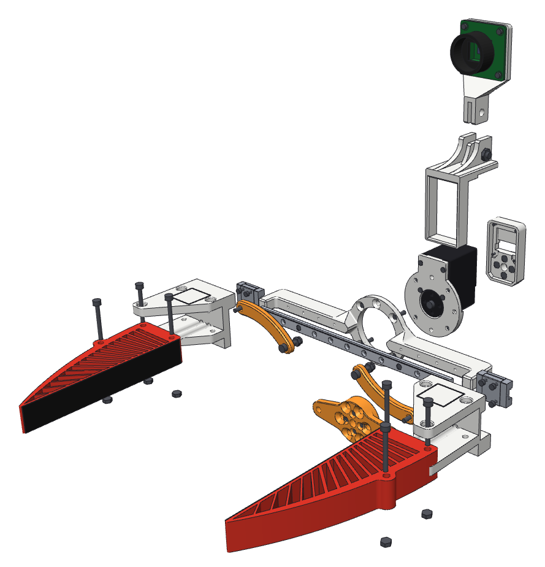

This guide builds the **Feetech variant** (STS3250 servo; an STS3215 fits the same way). Get the parts first
([Sourcing parts](../README.md#sourcing-parts)) and print them
([Printing the parts](../README.md#printing-the-parts)).

Every step has a short animation rendered from the Onshape assembly. The
full build is also available as one video:
[`media/assembly/assembly_full.mp4`](media/assembly/assembly_full.mp4).
Each step's clip is in [`media/assembly/`](media/assembly/) as `.mp4`.

> **Fasteners.** The CAD has no screws modelled; the screws in the
> animations are drawn in to show where each one goes.

**Tools:** hex keys 1.5 / 2 / 2.5 / 3 mm, a small Phillips screwdriver (servo
horn screw), a soldering iron for the heat-set inserts, and a computer with the
Waveshare bus servo adapter for step 7.

---

## Step 1 — Slide the two carriages onto the rail

| Parts | Fasteners |
| --- | --- |
| MGN7 rail (150 mm), 2× MGN7C carriage | — |

The carriages go on before the rail is screwed down. If they came on a
plastic dummy rail, slide them straight from the dummy onto the end of the
rail so no balls fall out. Check both run freely over the full length, then
push them to the middle.

## Step 2 — Fasten the rail to the rack

| Parts | Fasteners |
| --- | --- |
| `rack`, rail with carriages | 4× M2×6 socket head |

Lay the rail centred in the channel on the front face of the rack. With the
carriages pushed to the middle, screw it down with two M2×6 screws on each
side, through rail holes that line up with holes in the rack. They thread into
the plastic, so snug them without stripping. Then slide the carriages back out to the ends.

## Step 3 — Press in the heat-set inserts

| Parts | Fasteners |
| --- | --- |
| `finger_holder_left_n`, `finger_holder_right_n` | 2× M3 heat-set insert |

With a soldering iron (an insert tip helps), press an M3 heat-set insert into
the round boss of each finger holder. This is the pin for the link in step 10.
Keep the insert square and stop when it's flush; let it cool before loading
it.

## Step 4 — Bolt the finger holders to the carriages

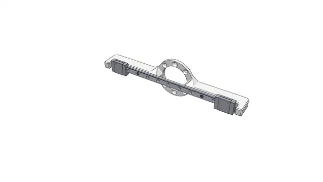

| Parts | Fasteners |
| --- | --- |
| finger holders with inserts | 8× M2×5 socket head |

Bolt each finger holder to a carriage with four M2×5 screws. They go into the
carriage's own M2 threads, so keep them short.

## Step 5 — Attach the TPU fingers

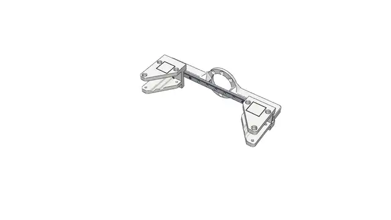

| Parts | Fasteners |
| --- | --- |
| 2× `soft_gripper_finger` (TPU), optional anti-slip pads | 6× M3×25 socket head, 6× M3 nut |

Slide each finger into its holder, push three M3×25 screws through from the
top and tighten the nuts underneath until the finger is clamped (TPU
compresses, so don't crank it). If you use anti-slip pads, stick an
18 × 119 mm strip on the inner face of each finger.

## Step 6 — Screw the gripper holder onto the servo

| Parts | Fasteners |
| --- | --- |
| STS3250 (or STS3215) servo, `feetech_gripper_holder` | 4× M2×6 |

Place the holder over the output face of the servo (the ring goes around the
output spline) and fix it with four M2×6 screws into the servo's side
mounting holes.

## Step 7 — Centre the servo, then fit the horn

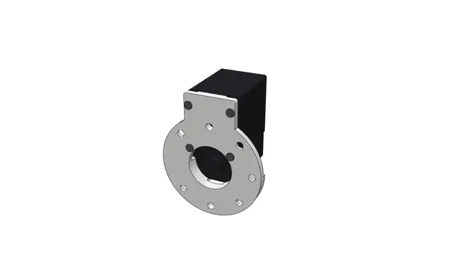

| Parts | Fasteners |
| --- | --- |
| servo horn (in the servo box) | horn centre screw (in the servo box) |

Before the horn goes on:

1. Connect the servo to the Waveshare bus servo adapter (12 V supply + USB-C to
   your computer).
2. Set the servo ID to the `id` in `conf_gripper_feetech.yaml` (default `1`)
   and move it to its centre position (raw position 2048). The Waveshare demo
   or Feetech's FD software both do this.
3. Press the horn onto the spline and screw in the centre screw.

Centring now keeps the whole finger stroke inside the servo's range, away
from the 0/4095 wrap-around.

## Step 8 — Join the servo module to the rack

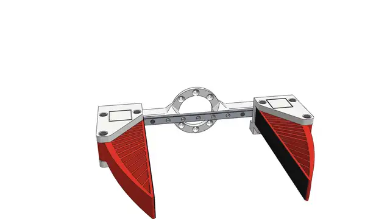

| Parts | Fasteners |
| --- | --- |
| servo module from steps 6–7 | 4× M3×10 countersunk, 4× M3 nut |

Bring the servo module up behind the rack so the horn sits in the rack's
ring. Fix the ring to the gripper holder with four countersunk screws from
the front (top left, top right, bottom left, bottom right) and nuts on the
back.

## Step 9 — Slide in the crank and bolt it to the horn

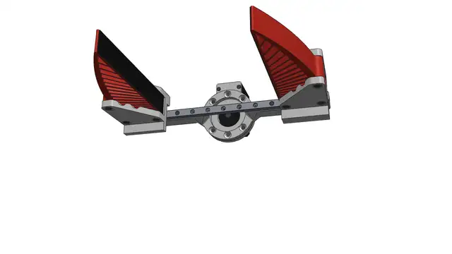

| Parts | Fasteners |
| --- | --- |
| `crank` | 4× M3×14 countersunk |

Slide the crank in from below, between the rack and the horn, and bolt it to
the horn with four M3×14 countersunk screws. With the servo still at centre,
orient the crank so its two arms stand roughly perpendicular to the rail;
that puts mid-stroke at servo centre. (The animation shows the gripper fully
open, where the arms sit close to the rail.)

## Step 10 — Connect the links

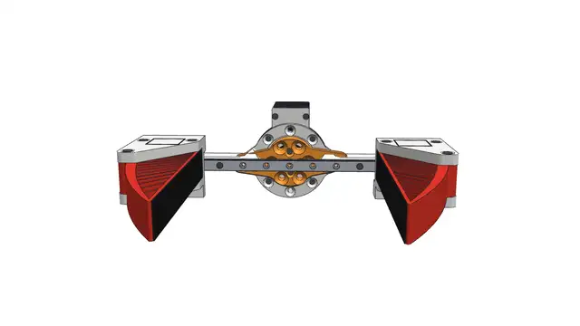

| Parts | Fasteners |
| --- | --- |
| `link-1`, `link-2` | 2× M3×14 socket head + 2× M3 nylon lock nut, 2× M3×10 socket head |

1. **Crank side:** put a link on the front of each crank arm and join them with
   an M3×14 cap screw and a nylon lock nut. Tighten only until the play is
   gone; the link must still swing freely.
2. **Finger-holder side:** screw an M3×10 through the other end of each link
   into the heat-set insert from step 3. Stop before it clamps the link.

Move the fingers by hand (servo unpowered): both should open and close
together without binding.

## Step 11 — Add the camera mount

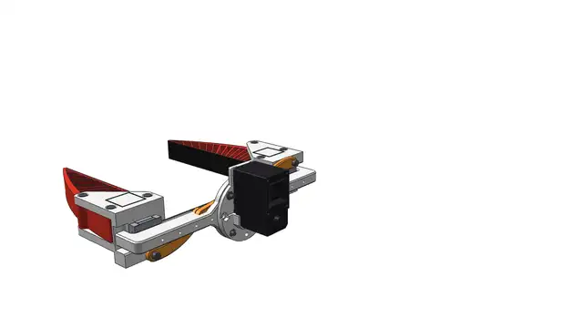

| Parts | Fasteners |
| --- | --- |
| `feetech_camera_mount_bottom`, `camera_holder_v3` | 1× M5×20 + M5 nut |

Fit the camera mount on the top of the servo, then hinge the camera holder on
it with the M5×20 bolt and nut. Leave it just loose enough to set the tilt,
and tighten it once the camera points where you want.

## Step 12 — Fit the arm adapter

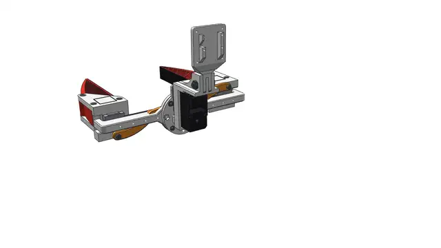

| Parts | Fasteners |
| --- | --- |
| `feetech_back_holder_to_horn`, `horn_spacer_3.5_mm` | 4× M3×10, 4× M2×6 |

1. **On the arm first:** put the 3.5 mm horn spacer on the adapter and screw
   both to the horn of your arm's `wrist_roll` servo with four M3×10 screws.
   The screw heads sit inside the adapter, so this is only reachable before
   the gripper is on.
2. **Then the gripper:** fit the adapter onto the back of the gripper servo
   and fix it with four M2×6 screws.

## Step 13 — Mount the HQ camera and the HDMI adapter

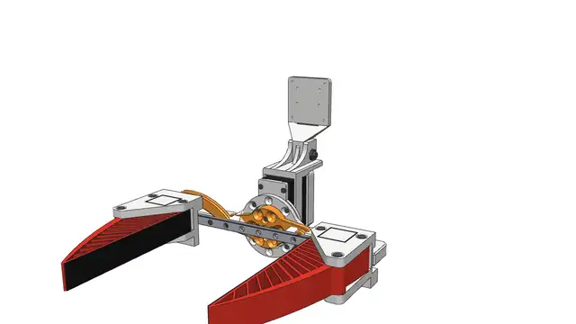

| Parts | Fasteners |
| --- | --- |
| Raspberry Pi High Quality Camera, wide-angle lens, CSI-to-HDMI adapter (camera-side board), 15-pin ↔ 15-pin ribbon cable | 4× M2×8 (camera), 2 screws for the adapter |

1. Connect the short 15-pin ↔ 15-pin ribbon cable to the camera, then fix the
   camera board to the holder with four M2×8 screws.
2. Screw the camera-side CSI-to-HDMI board to the back of the camera holder
   with two screws, HDMI port pointing down and back, and plug the other end
   of the ribbon cable into it.
3. Screw on the lens, set focus and lock it.
4. Run the HDMI cable along the arm to the computer-side board, and connect
   that board to your Raspberry Pi or Jetson with the second ribbon cable
   (15-pin → 22-pin for a Pi 5 or Jetson Orin, 15-pin → 15-pin for older Pis).

The animation shows the camera only; the adapter board and cables aren't in
the CAD.

## Done

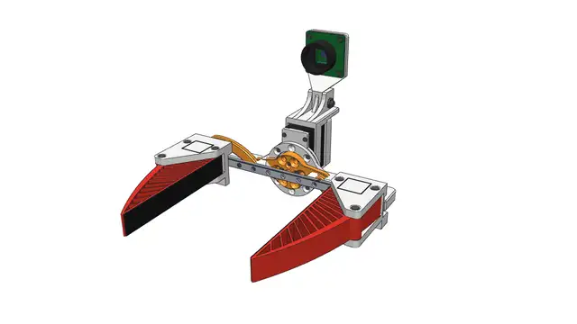

The servo turns the crank and the two links push the carriages along the
rail, so one servo drives both fingers symmetrically. Next, follow the
software steps in the [README](../README.md#using-it-in-a-robot): copy the
config, run `solarian calibrate` and `solarian calibrate-gripper-ranges`.

---

### Regenerating these animations

The animations, stills and print-oriented STLs are generated from the Onshape
assembly by [`tools/assembly_render`](../tools/assembly_render/README.md).
